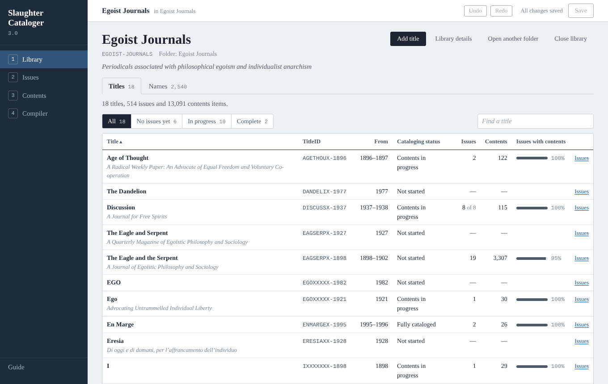
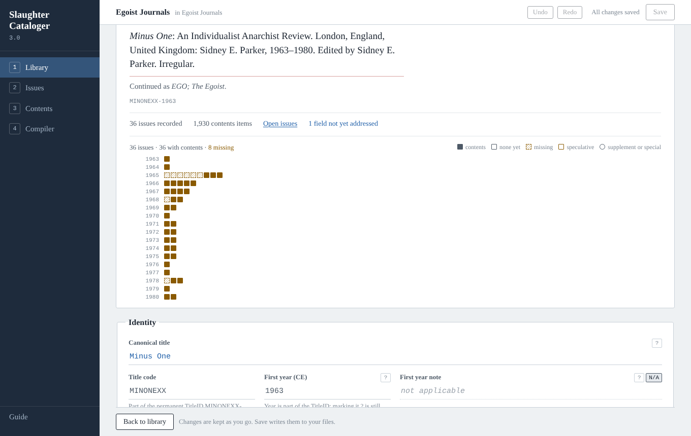
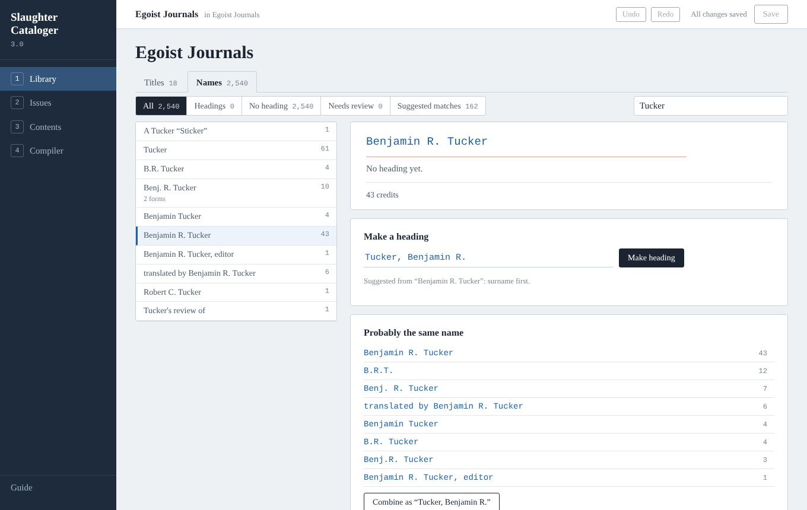
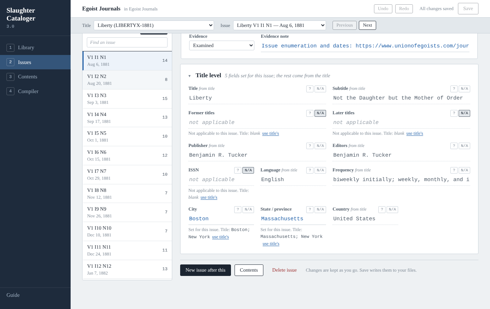
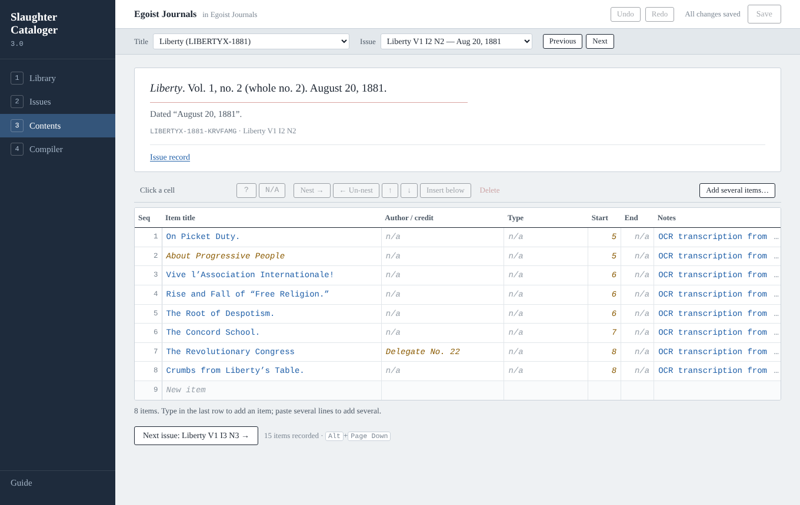
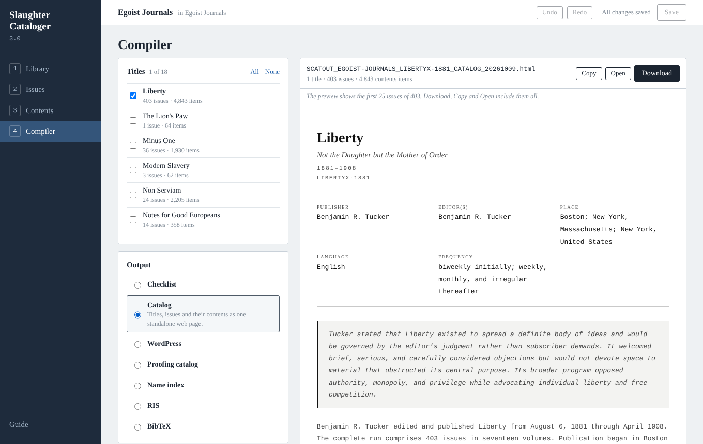

# Slaughter Cataloger

**A local-first browser app for cataloging serial publications.**

Build a structured, exportable bibliography of periodicals: newsletters, magazines, journals, newspapers, zines, bulletins, and anything else issued in numbered installments. Record each title, every issue, and what appears in each issue. Gather the different ways a person was credited under one heading. Compile checklists, catalogs, proofing sheets, name indexes and citation files.

Everything runs in your browser. Your catalog is a folder of plain CSV files that you own and can open in any spreadsheet. There is no account and no server, and no data leaves your machine.



---

## Getting started

1. **Get the app.** Download [`dist/slaughter-cataloger-3.html`](dist/slaughter-cataloger-3.html). It is one self-contained file and works offline. Alternatively, clone the repository and open `index.html`.
2. **Open it in Chrome or Edge** (desktop). See [browsers](#browsers) for the others.
3. **Start a new library** (pick an empty folder), or **Open library folder** to pick a folder of 3.0 CSV files.
4. Work through the four stages: **Library → Issues → Contents → Compiler**. The **Guide** at the bottom left of the app explains each one.

To try it without your own data, copy one of the folders in [`sample-data/3.0/`](sample-data/3.0/) somewhere and open that copy. Saving writes into the folder you open.

Coming from Beta 2? See [Upgrading from Beta 2](#upgrading-from-beta-2). Version 3.0 doesn't open Beta 2 files directly.

---

## The four stages

**1 · Library.** Your titles, with their cataloging progress, and the title record editor. Each title page shows its run as a strip: one row per volume or year, one square per issue. Squares mark which issues have contents recorded, which are speculative or supplements, and which numbers are missing.



The **Names** tab gathers every credited name in the library. It suggests headings ("Tucker, Benjamin R.") and finds forms that are probably the same person ("B.R.T.", "Benj. R. Tucker"). Headings never change the contents: each credit stays exactly as printed.



**2 · Issues.** Record issues one after another. A new issue follows on from the last one: its numbering, date and short name advance by the title's cadence, and you can change any of them. Issues inherit twelve title-level fields (publisher, editors, place, frequency and so on). An issue overrides a field only where it differs from the title. Gaps in a run are listed, and a run list sits beside the form.



**3 · Contents.** A spreadsheet-like grid per issue. You can:
- paste a table of contents (several lines at once, with tabs between columns);
- nest items under a section;
- reorder items;
- add several items at a time.

Authors and content types complete as you type.



**4 · Compiler.** Tick one title or several, choose an output, and see a live preview. Download, copy or open the whole output. The Compiler never writes into your library folder.

| Output | Format | For |
|---|---|---|
| Checklist | HTML, Markdown, plain text | the run as a list to tick off (plain, bibliographic, or IssueID first) |
| Catalog | standalone HTML | titles, issues and contents as one web page |
| WordPress | Gutenberg blocks | pasting the catalog into the WordPress code editor |
| Proofing catalog | printable HTML | checking the records against the issues in hand, one issue per page |
| Name index | HTML, Markdown, plain text | every credited name under its heading, with see-references |
| RIS | `.ris` | Zotero and other reference managers, one record per contents item |
| BibTeX | `.bib` | JabRef and LaTeX, one entry per contents item |

Output files are named `SCATOUT_<LIBRARY>[_<TITLEID>]_<TYPE>_<YYYYMMDD>.<ext>`.



---

## Your data: a folder of CSV files

| File | Name |
|---|---|
| Titles (one per library) | `SCAT_<SLUG>_TITLES.csv` |
| Issues (one per title) | `SCAT_<SLUG>_<TITLEID>_ISSUES.csv` |
| Contents (one per title) | `SCAT_<SLUG>_<TITLEID>_CONTENTS.csv` |
| Name headings (one per library) | `SCAT_<SLUG>_AUTHORITIES.csv` |

Every row names its tool, schema version (3.0) and library. Columns the app doesn't know are kept as they are. The files are UTF-8 text; when you save them from a spreadsheet, choose **CSV UTF-8** (in Excel, "CSV UTF-8 (Comma delimited)"), not plain "CSV".

**Permanent IDs.** Each ID is minted once and never changes:
- **TitleID:** `LIBERTYX-1881`, an 8-character title code plus the first year (`189X` or `XXXX` for unknown digits). It is fixed once the title exists.
- **IssueID:** `LIBERTYX-1881-KRT8NK2`, the TitleID, `K` and six random characters.
- **ContentID:** `LIBERTYX-1881-CPW4JB6`, the TitleID, `C` and six random characters.
- **AuthorityID:** `AU-3FQ8MW`, `AU-` and six random characters.

The random part of each ID uses digits 2–9 and capital letters, without I, O, L, X, 0 or 1.

**Field states.** Every field is one of:
- filled;
- speculative, marked **?** (inferred, uncertain, or from a secondary source; shown as `[1881?]` in outputs);
- **N/A** (considered, and doesn't apply);
- unaddressed.

**Inheritance.** An Issues file holds every issue's effective values, so it reads correctly on its own in a spreadsheet. The `Overridden Fields` column lists which values the issue sets itself, rather than taking them from the title.

---

## Saving, backups and recovery

**Save writes into your folder** (Chrome and Edge). Only files that changed are written, and each keeps its own CSV layout (BOM, line endings, quoting), so a small edit makes a small difference. "All changes saved" means every file in the folder holds exactly what you see.

**Backups are automatic and never written over.**
- The first time a save replaces a file in a session, the version on disk is copied into `_backups/<date-time>-<code>/`, a folder of that session's own, inside your library folder.
- If a file was changed by something else while the library was open (a spreadsheet, say), that version is copied too, and the save tells you where.
- Each copy is the file's exact bytes, read back and checked before the file is replaced. If a copy can't be made, the file isn't saved, and the message says why.
- If you delete `_backups` while the app is open, the next save makes a new one.
- Each backup folder has a `BACKUPS.txt` listing what every copy is, when it was made and why.
- **To go back to an earlier version,** copy it from `_backups/…` into the library folder under its original name, then reopen the folder.

**The browser keeps a working copy.** Every change is also written into this browser's storage as you make it. If the tab closes, the browser crashes or the computer restarts, open the app again: your work is there, marked unsaved, and the app asks for access to the folder again (**Allow access**).

Two limits:
- A change made in the instant before a crash can be lost.
- Clearing the browser's data for the page deletes the working copy.

The working copy is not a backup, so save often. If the browser can't store a change, a red notice says so, and stays until the whole library has been stored again. If something couldn't be brought back after a crash, the app says so when it reopens.

**One tab at a time.** Only one tab works on the library. A second tab offers **Use this tab instead**; the first then stops, including any save in progress, so the two don't overwrite each other. (In a browser without the Web Locks API — older than Chrome 69, Firefox 96 or Safari 15.4 — a take-over at the very instant the first tab is replacing a file can still let that write land after the second tab's save.)

**When the folder changes while you are away.** On reconnecting, the app:
- reads files that were added;
- reads again the files you haven't changed;
- keeps your version of files you have changed. Saving them then backs up the version on disk first.

A file that has disappeared keeps its records in the app, and nothing is written to its name until it's back or you remove it on the Library page. If the remembered folder now holds a different library, the app reads nothing from it and writes nothing into it.

**Files and rows the app can't read** are never written over:
- **A whole file that is malformed** isn't loaded, and the load report gives the line. Examples: a quote never closed, a column heading used twice, a row with more or fewer values than the header. Adding records that would go into that file is refused until you correct it.
- **A file that isn't UTF-8** (a spreadsheet's plain "CSV", in a Windows code page) isn't loaded either: reading it as UTF-8 would damage its accented letters, and saving would make that permanent. Save it again as CSV UTF-8 and reconnect.
- **Single rows that can't be taken in** are set aside and written back exactly as they were. Examples: a repeated ID, another library's row, a row of the wrong kind. The Library page lists them.

### Spreadsheet safety, and editing the CSVs elsewhere

A value starting with `=`, `+`, `-` or `@` (or a tab) is written with an apostrophe in front, so a spreadsheet doesn't run it as a formula: `-- END` is stored as `'-- END`. The app removes the apostrophe when reading. A value that itself starts with an apostrophe before one of those characters gets one more (`''-ism`), so everything the app writes reads back exactly.

In a file edited elsewhere, the same rule applies, the way spreadsheets read it:

| In the CSV | Read as |
|---|---|
| `'-ism`, `'@handle`, `'=SUM(1,2)` | `-ism`, `@handle`, `=SUM(1,2)`: the apostrophe is the escape |
| `''-ism` | `'-ism`: type the apostrophe twice to keep a literal one |
| `=SUM(1,2)` | `=SUM(1,2)`, as it is; the app adds the apostrophe when it next saves the file |
| `'Twas`, `'quoted'` | exactly as written: an apostrophe before anything else is never touched |

---

## Browsers

| Browser | How saving works | Status |
|---|---|---|
| **Chrome, Edge** (desktop, version 123 or later) | Straight into your library folder, with backups | **Supported.** Tested automatically in Chromium |
| Other Chromium browsers (Brave, Opera, Vivaldi, Arc) | Usually the same; some turn folder access off | Not tested |
| **Firefox, Safari** | Load the CSV files (pick or drop them); Save downloads the changed files. They count as saved only once you click **I've replaced the files**, after moving the downloads into your library folder | **Not tested in those browsers.** The same code paths are tested in Chromium with folder access and tab locking switched off |
| Phones and tablets | | Not supported |

Fonts come from Google Fonts when online; offline, the app uses fallback fonts and works the same.

---

## Upgrading from Beta 2

Version 3.0 reads only schema 3.0 files. Convert a Beta 2 library once with the converter, which needs [Node.js](https://nodejs.org) 18 or later:

```sh
node tools/convert-to-3.js "path/to/beta 2 folder" --out "path/to/new folder"
```

The converter:
- reads every Beta 2 CSV under the folder. Your files are never modified.
- merges dated copies. Copies of a Titles or Issues list (files sharing record IDs) are merged record by record: the newest file, by its modification date, wins, and records found only in older copies go into a `_left-out/` folder. Contents are merged an issue at a time: each issue's contents come from the newest file that has any for it. Lists that share no IDs are separate, and all are used.
- writes one Titles file per library, and one Issues and one Contents file per title, under the standard names.
- gives every contents item a permanent ContentID and links nested items.
- turns Beta 2 name authority lists (`AUTHORITY_<TitleID>.csv`) into the library's Authorities file.
- verifies the result by reading it back with the 3.0 reader.
- writes `CONVERSION-REPORT.md`, listing every difference between copies and what was kept.

Each library is written into its own folder, `<out>/<SLUG>/` (for example `new folder/EGOIST-JOURNALS/`): open that folder in the app. If a 3.0 folder also holds Beta 2 files, the app doesn't load them, says so on the Library page, and never changes them.

The Beta 2 apps remain in [`legacy/`](legacy/).

---

## Keyboard

| Keys | Does |
|---|---|
| Ctrl/⌘ + S | Save |
| Ctrl/⌘ + Z, Ctrl/⌘ + Shift + Z (or Ctrl + Y) | Undo, redo (every change, in any stage) |
| Ctrl/⌘ + Enter | Record the issue being drafted |
| Alt + Page Up / Page Down | Previous / next issue of the title (Issues and Contents) |
| Enter, Tab (contents grid) | Move down, move right; take a completion |

---

## For developers

The app is plain JavaScript with [Preact](https://preactjs.com) and [htm](https://github.com/developit/htm), both vendored in `js/vendor/`. There is no build step and no npm install: `index.html` runs straight from the folder. `tools/build.py` inlines everything into the single file `dist/slaughter-cataloger-3.html`.

```
index.html            the app (loads css/ and js/)
js/core/              pure logic, also run by the tests in Node: schema, CSV, records, store,
                      numbering, contents, names, catalog view model, outputs
js/platform/          folder access, browser storage, locks, backups, downloads
js/app/session.js     opening, restoring, reconnecting, saving
js/ui/                the four stages (Preact + htm)
tools/                build, Beta 2 converter, TitleID migration, tests
sample-data/          real libraries used by the tests (3.0 and Beta 2)
dist/                 the single-file build
legacy/               the Beta 2 apps
```

`CLAUDE.md` holds the working notes: the architecture, and the decisions behind each mechanism.

### Tests

```sh
sh run-tests.sh                 # the release check: every suite, nothing may be skipped
sh run-tests.sh --quick         # Node suites only (a few seconds)
```

You need Node 18+ and Python 3. The browser suites need Playwright with Chromium (`npm i -g playwright && npx playwright install chromium`). The format checks install the parsers they use into a temporary folder. If any check fails, or a required one can't run (Playwright missing, say), the script exits with status 1. The options that skip checks (`--no-browser`, `--offline`, `--quick`) exit with status 3, "not a release check". A skipped run is never reported as a pass.

| Suite | Checks |
|---|---|
| `test-numbering.js`, `test-store.js`, `test-names.js` | numbering, dates, short names, gaps, contents nesting and paste; undo/redo and changed-file revisions; credits, headings and matching |
| `test-outputs.js` | the catalog view model and every output, on the whole Egoist Journals library |
| `test-safety.js` | CSV values and rows never dropped or changed; malformed files refused; nesting links; inheritance |
| `test-backups.js` | backups never written over and byte for byte, with a frozen clock and forced name collisions |
| `test-roundtrip.js`, `convert-to-3.js` | Beta 2 → 3.0 conversion is lossless and verified |
| `test-formats.js` | BibTeX, RIS and WordPress outputs read by Better BibTeX's parser, citation-js and Gutenberg's own parser |
| `test-walkthrough.js` | the app end to end in Chromium |
| `test-session.js` | saving, restoring, reconnecting, two tabs, crashes, failed writes, and the browser's real file API |

GitHub Actions runs `run-tests.sh` on every push (`.github/workflows/tests.yml`).

---

## Status

**3.0** — October 2026. A ground-up rebuild of the Beta 2 suite as one app, reviewed for data safety before release.

## Release history

**3.0** — October 2026.
- **One app** instead of five, on one schema, one store and one view model for every output.
- **Saving straight into the library folder,** with automatic backups that are never written over and conflict detection.
- **A working copy in the browser,** with crash recovery; one tab at a time.
- **Issue drafting** with auto-advance.
- **Inherited title-level fields,** overridden only where an issue differs.
- **The contents grid,** with paste, nesting and completion.
- **Run strips** showing gaps.
- **Name headings,** with a library-wide name index.
- **New outputs:** BibTeX and the name index.
- **Permanent ContentIDs and AuthorityIDs.**
- **A one-time converter** from Beta 2.

**Beta 2.7** — 2026. The four apps combined into a single file (`legacy/beta-2.7/`).

**Beta 2.6** — July 2026. Titles dashboard for loading a library's Titles, Issues and Contents files together and viewing cataloging progress across all titles.

**Beta 2.5** — July 2026.
- New Compiler output modes: WordPress Catalog (native Gutenberg blocks), Proofing Catalog (print-optimised verification document), Full Catalog HTML.
- Volume/year grouping in all catalog outputs, and a scope panel for filtering by volume or year group.
- An active titles filter.
- A unified readiness function and full RIS cross-validation.

**Beta 2.0** — July 2026. Suite architecture: four apps (Titles, Issues, Contents, Compiler). IssueID permanent key system. Checklist and RIS outputs. Schema metadata in every CSV. Structured filenames. Formula injection protection.

**Beta 1.1** — July 8, 2026. Printer and Printer Location fields. Supplement/Special fixes. Import Replace/Append/Cancel.

**Beta 1.0** — July 6, 2026. Initial release.
